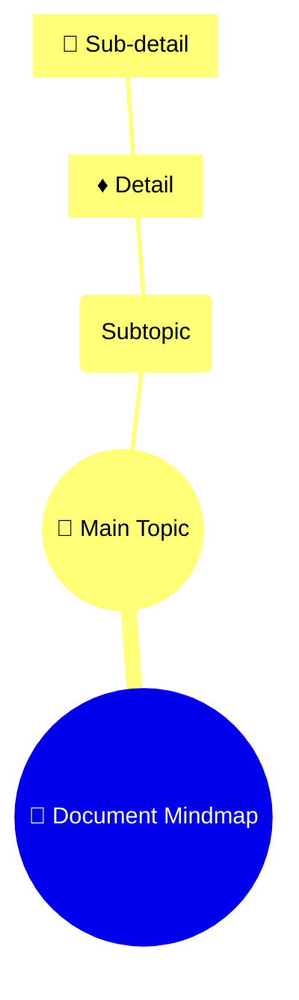

# Mindmap Generator (SGLang 기반)

SGLang 로컬 모델을 사용한 지능형 마인드맵 생성 모듈입니다.

## 🎯 주요 특징

- **SGLang 로컬 모델**: Qwen3-8B 모델을 로컬에서 직접 로드하여 사용
- **완전한 계층 구조**: Root → Topics → Subtopics → Details → Sub-details (5단계)
- **Weaviate 클러스터링**: 의미적 주제 클러스터링으로 정확한 주제 추출
- **Reality Check**: 생성 내용을 원본과 대조 검증
- **중복 제거**: Fuzzy matching + Semantic similarity
- **다양한 출력 형식**: Mermaid, Markdown, HTML, Interactive HTML
- **통합 설정 관리**: notebooklm/config.py에서 모든 모델 설정 관리

## 📁 구조

```
skill/mindmap/
├── __init__.py                 # 모듈 export
├── mindmap_generator.py        # 메인 생성기 (4456줄)
├── weaviate_service.py         # Weaviate 연동
├── segment_processor.py        # 문서 세그먼트 처리
├── emoji_cache.json            # 이모지 캐시 (99KB)
├── visualize_mindmap.html      # HTML 템플릿
└── README.md                   # 이 파일

출력 디렉토리:
nextits_data/Results/8.mindmap/  # 모든 마인드맵 출력
```

## 🚀 사용 방법

### API를 통한 사용 (권장)

```bash
# 1. 마인드맵 생성 시작
curl -X POST http://localhost:5001/api/v1/mindmap/generate \
  -H "Content-Type: application/json" \
  -d '{
    "filename": "document.md",
    "max_topics": 8
  }'

# 응답: {"task_id": "uuid", "status": "pending"}

# 2. 상태 확인
curl http://localhost:5001/api/v1/mindmap/status/{task_id}

# 3. 마인드맵 목록
curl http://localhost:5001/api/v1/mindmap/list

# 4. 마인드맵 내용 조회
curl http://localhost:5001/api/v1/mindmap/content/{filename}?format=html
```

### Python에서 직접 사용

```python
from skill.mindmap.mindmap_generator import generate_mindmap_for_api

# 마인드맵 생성
result = await generate_mindmap_for_api(
    document_content="문서 내용...",
    request_id="test_001",
    max_topics=8
)

# 결과 확인
print(result["mermaid"])          # Mermaid 문법
print(result["markdown"])         # Markdown 아웃라인
print(result["html"])             # HTML 뷰어
print(result["interactive_html"]) # 인터랙티브 HTML
```

## ⚙️ 설정

`notebooklm/config.py`에서 마인드맵 모델 설정:

```python
class RAGConfig:
    # 마인드맵 생성 모델
    MINDMAP_MODEL = "Qwen/Qwen3-8B"
    MINDMAP_DEVICE = "cuda:0"
    MINDMAP_MEM_FRACTION = 0.5  # GPU 메모리 50% 사용
    MINDMAP_MAX_TOKENS = 8192
    MINDMAP_TOKEN_BUFFER = 500
    
    # Weaviate 설정 (공유)
    WEAVIATE_HOST = "127.0.0.1"
    WEAVIATE_PORT = 8080
```

## 📊 API 엔드포인트

| 엔드포인트 | 메서드 | 설명 |
|---|---|---|
| `/api/v1/mindmap/generate` | POST | 마인드맵 생성 시작 |
| `/api/v1/mindmap/status/{task_id}` | GET | 생성 상태 확인 |
| `/api/v1/mindmap/list` | GET | 마인드맵 목록 조회 |
| `/api/v1/mindmap/content/{filename}` | GET | 마인드맵 내용 조회 |
| `/api/v1/mindmap/{filename}` | DELETE | 마인드맵 삭제 |

## 💡 출력 형식

### 1. Mermaid 문법 (.mmd)


### 2. Markdown 아웃라인 (.md)
```markdown
# Document Title

## 🎯 Main Topic

### Subtopic

♦️ Detail text here

🔸 Sub-detail text here
```

### 3. HTML 뷰어 (.html)
- Mermaid 렌더링
- 확대/축소 기능

### 4. Interactive HTML (.html)
- 인터랙티브 노드
- 드래그 & 줌
- 시각적 계층 구조

## 🔄 처리 흐름

1. **문서 분석**: 문서 타입 자동 감지 (11가지 타입)
2. **세그먼트 처리**: 문서를 의미 단위로 분할
3. **Weaviate 클러스터링**: 의미적 유사도 기반 주제 그룹화
4. **주제 생성**: LLM으로 주제 및 하위 주제 생성
5. **Reality Check**: 원본과 대조하여 환각 제거
6. **중복 제거**: Fuzzy + Semantic 유사도로 중복 제거
7. **출력 생성**: 4가지 형식으로 변환

## 🎨 핵심 알고리즘

### DocumentType 자동 감지
11가지 문서 타입 자동 분류:
- Research Paper, Technical Documentation
- Business Report, Tutorial/Guide
- News Article, Blog Post
- Meeting Notes, Legal Document
- Educational Material, Creative Writing
- General

### 계층 구조 (5단계)
```
Root (문서 제목)
  ├─ Topic (주요 주제)
  │   ├─ Subtopic (하위 주제)
  │   │   ├─ Detail (세부 내용)
  │   │   │   └─ Sub-detail (추가 세부 내용)
```

### Reality Check
생성된 내용을 원본 문서와 대조:
- 각 노드를 원본 청크와 비교
- LLM으로 검증 (YES/NO)
- 검증되지 않은 노드 제거
- 구조 보존 모드 (너무 많이 제거되면 원본 유지)

## ⚡ 성능 최적화

- **GPU 메모리 관리**: `mem_fraction_static`으로 메모리 제한
- **병렬 처리**: 배치 단위 검증
- **캐싱**: 이모지 캐시 (99KB)
- **Retry 메커니즘**: Exponential backoff with jitter

## 🔧 의존성

```
sglang>=0.3.0           # SGLang 엔진
nest-asyncio            # 이벤트 루프 호환
weaviate-client         # 벡터 DB
termcolor               # 컬러 로깅
fuzzywuzzy              # 중복 제거
python-Levenshtein      # 문자열 유사도
nltk                    # 문장 분리
```

## 📝 주의사항

- **GPU 필수**: CUDA 지원 GPU 필요
- **메모리**: 최소 8GB GPU 메모리 권장
- **처리 시간**: 문서 길이에 따라 2-5분 소요
- **Weaviate**: Weaviate 서버 실행 필요 (127.0.0.1:8080)

## 🆚 기존 버전과의 차이

| 항목 | 기존 (AsyncOpenAI) | 현재 (SGLang) |
|---|---|---|
| 모델 로드 | 서버 연결 | 로컬 로드 |
| 의존성 | openai, anthropic 등 | sglang만 |
| GPU 사용 | 서버에서 관리 | 직접 관리 |
| 메모리 | 서버 의존 | 설정 가능 |
| 속도 | 네트워크 지연 | 로컬 실행 |

## 📄 라이선스

MIT License
